# Dunai hajókövető – adatbázis terv

**Verzió:** 1.3 (2026-11-14)
**Hatály:** a készülő weboldal és mobilapplikáció közös, háttérben futó adatbázise
**Nyelvek:** magyar (hu) · német (de) · angol (en)
**Területek:** Duna-rendszer és Balaton-tó – elkülönítve (2.10 fejezet)

**Kapcsolódó dokumentumok:** [`docs/funkcio-leiras.md`](docs/funkcio-leiras.md) (funkcióleírás) · [`docs/release-terv.md`](docs/release-terv.md) (release terv) · [`docs/r1-adat-terv.md`](docs/r1-adat-terv.md) (R1 adat-terv) · [`docs/ais-vevo-terv.md`](docs/ais-vevo-terv.md) (saját AIS vevőhálózat) · [`docs/sema-core.mmd`](docs/sema-core.mmd) · [`docs/sema-irodalom.mmd`](docs/sema-irodalom.mmd)

**v1.3 változás:** a **saját AIS vevőhálózat** mint elsődleges adatbeszerzési mód rögzítése (új `ais_receiver_site` tábla), és a **Balaton-katalógus hatókörének szűkítése** (kishajók és vitorlások kihagyása).

**v1.2 változás:** **AIS-first azonosítási modell** – a hajó elsődleges kulcsa az MMSI (nem az ENI), az ENI az AIS Inland FI 10 üzenetből érkezik opcionális enrichmenteként; új `vessel_data_origin` mezőnkénti eredettábla és `verification_level` (bizonyossági szint). A folyó-km közvetlenül az AIS fairway hectometre mezőből jön (a Duna km-skálája: Sulina 0), így a geometriai km-illesztés kiesik. Új: `draught_reference` (RNW).

**v1.1 változás:** Balaton elkülönítése (terület-diszcriminátor, `vessel_identifier` mellék-tábla, szezon- és menetrend-táblák), valamint az első release (R1) katalógus-központú igényéhez igazított azonosítási modell.

---

## 0. Összefoglaló döntési javaslat

| Terület | Javaslat | Miért |
|---|---|---|
| Adatbázis-motor | **PostgreSQL 16 + PostGIS 3.4** | Erős relációs modell, kiforrott geospatial (Pont/LineString), partícionálás, JSONB, szabványos SQL, olcsó üzemeltetés |
| Földrajzi modell | PostGIS `geometry(Point,4326)` + **folyó-km** (`river_km`) első osztályú attribútumként | A Dunán a „hová tartasz" kérdés a km-hez képest értelmezhető; a GPS-koordináta önmagában nem elég |
| Hajóazonosítás | **MMSI** az elsődleges kulcs (minden AIS-hajónál van), **ENI** opcionális (a belvízi AIS Inland FI 10 üzenet első mezője) | Az MMSI sosem hiányzik; az ENI csak Inland AIS felszerelésnél érkezik, de akkor a hajó egész életére szól (2016/1629/EU 18. cikk) |
| Területi elkülönítés | A `vessel.operating_area` mező választja el a **Dunát** és a **Balatont**, külön azonosító-táblával | A Balaton-hajóknak nincs ENI-jük, a hajószámuk a kulcs; egyetlen „összes hajó" lista félrevezető lenne (lásd 13. fejezet) |
| Fő nyelvi modell | Fordítás **mellék-táblákban** (`*_i18n`), nem `name_hu/name_de/name_en` oszlopokban | A fordítandó mezők száma és halmaza entitásonként változik; 3 nyelv esetén 40+ táblánál a „nulla vagy három" oszlopminta karbantartási réteget |
| Élő adat | AIS-pozíció **előzménnyel**, havi partícionálással, 30 s → 5 perc → 1 óra felbontás-lépcsővel | 1 perc feletti pontosság a térképen nem látszik, viszont a tárolás 10×-es |
| Konvoj | Külön `convoy` / `convoy_member` modell | A Duna flotta ~82%-a **bárka**, aminek nincs saját AIS-e; a pozíciót a toló/vontató adja |
| Statikus + dinamikus szétválasztás | Referenciaadatok (`vessel`, `port`, `lock`) vs. eseményadatok (`position`, `voyage`) | A referenciatáblák ritkán, az eseményadatok másodpercenként változnak → eltérő tárolási és frissítési stratégia |

> **Fontos domain-korlát:** a teljes Duna-flotta kb. **3 300–3 500 hajó**, de kb. **82%-a nem önjáró bárka**. AIS-vel közvetlenül azonosítható egységekből (önjáró teherhajó, toló, vontató, személyhajó) kb. **1 300** van. A bárkák helyzetét *konvojként* kell kezelni, különben a térkép 2/3-a üres marad.

---

## 1. Cél, hatókör és a terv keretei

### 1.1 Funkcionális célok

**Weboldal (SEO-kritikus, linkelhető):**
1. Élő térkép a Dunán (szűrés hajótípusra, területre, mozgásra)
2. Hajólista és hajó-adatlap (ENI, MMSI, típus, méretek, üzemeltető, aktuális pozíció, utazás-előzmény)
3. Kikötő-, terminál- és zsilip-adatlapok (kapacitás, várakozási idők, rakománykezelés)
4. Helyzet- és vízállás-tájékoztató (szárazállási korlátozások, zárások)
5. Járat-tervező útvonal (pl. Rotterdam–Budapest, Belgrad–Konstanca) ETA-val
6. SEO / blogtartalom három nyelven

**Mobilapplikáció (push-alapú, offline-képes):**
1. Ugyanaz a térkép + élő pozíció gyors frissítéssel
2. „Figyelt hajók" lista, push értesítés: érkezés, késés, zsilip-várakozás
3. Útvonal-tervező + értesítés induláskor / cél érkezésekor
4. Gyors keresés (ENI, MMSI, hajónév, UN/LOCODE)

### 1.2 A terv lefedett döntései

| Döntés | Válasz | Következmény a sémában |
|---|---|---|
| Élő AIS pozíció tárolása | **Igen, előzménnyel** | `position` (partícionált), `position_archive`, `position_hourly` |
| Hajók köre | **Minden hajótípus** (teher, folyadék, bárka, toló, vontató, személy, kiránduló, munkahajó, vontatóbárka-összekötés) | `vessel_type` bő kódkészlet, `cargo_type`, `convoy` modell |
| Formátum | **Markdown terv + Mermaid sematikus ábra** | Dokumentum + `.mmd` forrásfájlok |
| Nyelvek | **hu / de / en** | `language`, `content_key` + `content_text`, `*_i18n` táblák, 3 nyelvű szerkesztői státusz |

### 1.3 A hatókörön **kívül** eső területek (későbbi fázis)

Fogyasztási árkalkuláció, hajóbérlés / fuvar-megbízás online felülete, fizetés, chat, chatbot-értékesítés, kikötői kapacitás-előfoglalás, személyzet-kezelés. Ezekhez a modell úgy készül, hogy később **külön modulként** ráépíthető legyen (a `cargo_type`, `capacity` és `operator` mezők előkészítettek), de a séma nem tartalmaz nekik helyet.

---

## 2. Az adatok köre (adatkörök)

Az adatbázis **7 adatkörre** bontható. A körök egymásra épülnek: a 2. pont nélkül a 3–7. pont nem értelmezhető.

### 2.1 A vízút modellje (a „színtér")

| Adatkör | Tartalom | Példa |
|---|---|---|
| Folyó (waterway) | Duna, mellékfolyók (Mura, Dráva, Száva, Tisza), csatornák (Rajna–Duna, Bécsi–Duna) | `Duna`, `Sava`, `RMD` |
| Folyószakasz (river_section) | Szakaszhatárok km-ben, országonként, kockázati besorolással | „Baja–Mohács", „Szob–Budapest" |
| Kikötő / állás (port) | Kód, UN/LOCODE, típus (közforgalmi kikötő, terminál, zsiliprész, járóműhely, hajógarázs, üzemanyag-állás) | „Dunaharaszti", „Fehérvári Cs. Közforgalmi Kikötő" |
| Kötődöm (berth) | Darabszám, hossz, mélység, max. merülés | 12. számú kötődöm |
| Zsilip (lock) | Kamraszám, kamrahossz/‑szélesség, max. merülés, üzemeltető, átlagos áthaladási idő | „Gabčíkovo", „Žeželj", „Iron Gate I" |
| Terminál (terminal) | Rakománytípusok, éves kapacitás, kezelő berendezés | „MAHAP terminál" |
| Mérőállomás (gauge) | Vízállás-mérő pont, dátumreferencia | „Mohács", „Budapest" |
| Előjelző táblázat | Fontos kikötők, zsilip- és szakaszhatár-pontok `river_km` → geometria leképezéshez | |

### 2.2 A hajó és a flotta

| Adatkör | Tartalom | Fontos szabály |
|---|---|---|
| Hajó (vessel) | ENI, IMO, MMSI, hívójel, típus, zászló-ország, üzemeltető, hazai kikötő, építési év, hossz, szélesség, max. merülés, GT, DWT, TEU, motorteljesítmény, AIS-osztály, státusz | **ENI = egyedi**, MMSI = részleges egyedi (`WHERE mmsi IS NOT NULL`) |
| Hajónév | Forgalmi név + korábbi nevek (`vessel_alias`) | Három nyelven tárolva |
| Hajótípus | UN-rek. 28 szerinti kódok + szállítási kategória | Kódkészlet, nem szabad szöveg |
| Üzemeltető (operator) | Cég, ország, webhely | |
| Oklevél / engedély | Közlekedési engedély, hajóbiztosítás, hatályosság | Időbeli, külön tábla |
| **Konvoj (convoy)** | Vontatási egység: vezető toló + bárkák | A bárka pozíciója a vezetőn keresztül értelmezendő |

**A konvoj-korlát következménye:** az adatbázisban a bárka **saját AIS-pusztulást nem kap**; a `position` táblában a bárka számára is kerüljön **értelmezett pozíció** (a vezető pozíciója + a konvoj geometriai eltolás), de `source_kind = 'derived'` jelöléssel. A frontend így tudja, hogy „ez becslés", és nem mutat hamis pontosságot.

### 2.3 Élő pozíció és előzmény

| Adatkör | Tartalom |
|---|---|
| Nyers AIS-üzenet (opcionális) | `ais_message_raw`: NMEA szöveg vagy bináris payload, kapcsolódási metaadatok — 7–14 nap |
| Pozíció | Időbélyeg, geometria, SOG (m/s), COG, irány, navigációs állapot, ROT, AIS-pontosság, méretek, forrás, üzenettípus |
| Aggregált pozíció | 5 perces és 1 órás átlagolt trajektória (hosszú távú elemzéshez) |
| Jelvesztés (`ais_gap`) | Mikor volt egy hajó „néma", és miért (feltételezett ok: kikötő, antenna, adatforrás) |
| Felhasználói javítás | Közösségi pozíció-jelentés hibás AIS-ponthoz |

### 2.4 Utazások (voyage) és megállók

| Adatkör | Tartalom |
|---|---|
| Utazás | Indulási/érkezési kikötő, tervezett és tényleges időpontok, státusz, bizonyosság |
| Megálló (`voyage_stop`) | Sorrend, kikötő, tervezett és tényleges érkezés/indulás, állapot (tervezett → megérkezett → várakozik zsilipnél → elindult) |
| Rakomány | Típus (NST-kód), mennyiség tonna, veszélyes áru jelölés (ADN/IMDG) |
| Útvonal-terv (`route`) | Tipikus kereskedelmi útvonalok, távolság, szokásos idő |
| ETA-becslés | Becsült érkezés + korábbi/későbbi konfidencia-intervallum + modellverzió |

### 2.5 Zsilipátjárás és várakozás

| Adatkör | Tartalom |
|---|---|
| Átjárás | Zsilip, irány, várakozási kezdet, belépés, kilépés, várakozási idő |
| Várakozási sor | Pozíció a sorban, becsült áthaladás |
| Zsilip-státusz | Nyitva/zárva, karbantartás, szezonális korlátozás |

### 2.6 Tartalom, tájékoztatók, események

| Adatkör | Tartalom |
|---|---|
| Közlemény (notice) | Hivatalos hajózási tájékoztató, hatályosság, hely, forrás-URL |
| Esemény (event) | Zárás, baleset, korlátozás, karbantartás, fokozott ellenőrzés – geo + folyó-km + időtartomány |
| Cikk / blog (`article`) | SEO-tartalom, három nyelven, slug-ekkel és kategóriákkal |
| UI-szövegek | Rendszerüzenetek, gombfeliratok, súgó — kulcs alapú, fordítási státusszal |

### 2.7 Felhasználó és alkalmazás

| Adatkör | Tartalom |
|---|---|
| Felhasználó | Nyelv, mértékegység-rendszer, állapot, hitelesítési azonosító |
| Figyelőlista | Figyelt hajók + szűrők + értesítési csatorna |
| Értesítési szabály | Trigger (érkezés, késés, zsilip, vízállás), paraméterek |
| Értesítés | Kibocsátás, kézbesítés, csatorna, állapot |
| Eszköz / push token | Platform, token (hashelve), utolsó aktivitás |
| Utazás-terv | Indulási/érkezési kikötő, szűrők, megosztási link |
| Helyzet-jelentés | Felhasználó által küldött pozíció-javítás |
| Visszajelzés | Kategóriával (adatpontosság, UI, egyéb) |
| API-kliens | B2B-integrációkhoz kulcs, hatókör, kvóta |

### 2.8 Rendszer- és meta-adatok

Nyelvkatalógus, ország, mértékegység-konverzió, valuta + devizaárfolyam, adatforrás- és licenc-nyilvántartás, adatminőségi események, ETL-futások naplója, audit napló, feature flag-ek.

### 2.9 Adatkör-mátrix

| Adatkör | Statikus/dinamikus | Várható méret | Nyelvek | Első fázisban? |
|---|---|---|---|---|
| Vízút, szakasz, kikötő, zsilip | Statikus | ~1 500 sor | Igen (név) | ✅ |
| Hatótípus, üzemeltető | Statikus | ~200 sor | Igen | ✅ |
| Hajó (flotta) | Kvázistatikus | ~3 500 sor | Igen (név) | ✅ |
| Konvoj | Dinamikus | ~100–300 aktív | – | ✅ |
| Pozíció (30 s) | Dinamikus | ~2 M sor/nap | – | ✅ |
| Pozíció-archívum (5 p / 1 ó) | Dinamikus | ~220 M / ~62 M sor | – | ✅ |
| Utazás, megálló | Dinamikus | ~5 000–15 000 aktív | Igen (státusz) | ✅ |
| Zsilipátjárás | Dinamikus | ~50 000/év | – | ✅ |
| Közlemény, esemény, cikk | Félstatikus | ~10 000 | Igen | ✅ |
| Felhasználó, figyelőlista | Dinamikus | Iskola méretű | – | ✅ |
| Vízállás | Idősor | ~30 mérőállomás × 10 perces | – | ✅ |

### 2.10 A Balaton elkülönítése (v1.1 módosítás)

A katalógus két területet kezel, amelyek **nem ugyanazokkal az azonosítókkal és más szezonlogikával** működnek. A séma ezt az alábbiak szerint kezeli.

**a) Terület-diszcriminátor:** a `vessel.operating_area` (`duna` | `balaton`) minden hajót, kikötőt, útvonalat és szűrőt egyértelműen hozzárendel a területhez. A katalógus soha nem mutat vegyes listát.

**b) Azonosítók – a `vessel_identifier` mellék-tábla:** az `eni` oszlop a `vessel` táblából nem törlődő, hanem **részleges egyediségű** lesz (`WHERE eni IS NOT NULL`), és megjelennek a további azonosítók is:

| `identifier_type` | Duna | Balaton | Forrás |
|---|---|---|---|
| `eni` | ✅ kötelező | ❌ nincs | ENI-nyilvántartás |
| `imo` | ✅ ha van | ✅ ha van | hajószám-adatbázis |
| `mmsi` | ✅ | ⚠️ nagyhajóknál | AIS |
| `callsign` (nemzetközi hajószám) | ✅ | ✅ kötelező nagyhajónál | hajószám-adatbázis |
| `national_reg_no` (nemzeti hajónyilvántartási szám) | – | ✅ | Közlekedési Hatóság |
| `internal_code` (belső kód) | ✅ | ✅ | szerkesztői |

**c) A Balaton-tó a vízút-hierarchiában:** `waterway` (`type = 'lake'`) → három `basin` (nyugati / keszthelyi-öböl, középső / balatonszemesi, keleti / siófoki). A `river_section` a Dunára használatos fogalom (folyó-km alapú); a Balatonon a **`partkm`** (a Siófoki-kőtől mért partkilométer) és a **medence** a megfelelő választó. A `position` táblához ezért külön `basin_id` és `shoreline_km` mező kerül a `river_km` mellé (mindkettő nullable).

**d) Kikötők:** a Duna `port` rekordjaihoz `port_type = 'marina'` típusú Balaton-kikötők társulnak, a `marina` kiegészítő táblával (rendkívüli horgonyzási lehetőség, védett hely, kikötőrend hivatkozás, üzemeltető).

**e) Szezon:** a `vessel_service_period` tábla a Balatoni hajók éves közlekedési időszakát írja le (`season_start`, `season_end`, `service_status`), a Duna-hajóknál pedig a tábla üres (egész éves üzem). A Balaton-katalógus „szezonban közlekedik" állapota innen jön.

**f) Menetrend:** a `vessel_schedule` tábla a Balatoni hajók heti menetrendjét tartalmazza (`weekday`, `departure_time`, `route_id`, `valid_from`, `valid_to`), R3-től használva.

**g) Adatkör-mátrix kiegészítése:**

| Adatkör | Terület | Várható méret | Kötelező |
|---|---|---|---|
| `basin` (Balaton-medencék) | Balaton | 3 | igen |
| `marina` (balatoni kikötők) | Balaton | 70–80 | igen |
| `vessel_service_period` (szezon) | Balaton | ~200 | igen |
| `vessel_schedule` (menetrend) | Balaton | ~2000 | R3 |
| `vessel_identifier` | mindkettő | ~4 000 | igen |

**Adatvédelmi megjegyzés:** a Balatoni kisgéphajók és vitorlások adatai közérdeklődésű nyilvántartásból származnak, a személyhajók adatai pedig a hatósági nyilvántartásból – mindkettő nyilvános jellegű. Személyes adatot (kapitány, tulajdonos magánszemély) egyik forrás sem tartalmaz, ezért a `vessel` entitás ezeket nem is őrizheti.

---

## 3. Logikai modell

A teljes modell három diagramra bontva olvasható. A Mermaid forrásfájlok: [`docs/sema-core.mmd`](docs/sema-core.mmd), [`docs/sema-irodalom.mmd`](docs/sema-irodalom.mmd).

### 3.1 Core – vízút, flotta, pozíció, utazás

```mermaid
erDiagram
    WATERWAY        ||--o{ RIVER_SECTION  : "szakaszai"
    WATERWAY        ||--o{ PORT           : "part"
    WATERWAY        ||--o{ GAUGE          : "meroes"
    COUNTRY         ||--o{ PORT           : "orszaga"
    COUNTRY         ||--o{ VESSEL         : "zaszlo"

    VESSEL_TYPE     ||--o{ VESSEL         : "tipusu"
    OPERATOR        ||--o{ VESSEL         : "uzemelteti"
    OPERATOR        ||--o{ TERMINAL       : "uzemelteti"
    OPERATOR        ||--o{ LOCK           : "uzemelteti"

    PORT            ||--o{ BERTH          : "kotok"
    PORT            ||--o{ TERMINAL       : "terminalai"
    PORT            ||--o{ LOCK           : "zsilipei"
    PORT            ||--o{ VOYAGE_STOP    : "megallok"

    VESSEL          ||--o{ VESSEL_I18N    : "nevei"
    VESSEL          ||--o{ VESSEL_ALIAS   : "korabbi nevei"
    VESSEL          ||--o{ VESSEL_CERT    : "engedelyei"
    VESSEL          ||--o{ POSITION       : "poziciok"
    VESSEL          ||--o{ VOYAGE         : "utazasok"
    VESSEL          ||--o{ CONVOY_MEMBER  : "konvojtag"
    VESSEL          ||--o{ AIS_GAP        : "jelvesztes"
    VESSEL          ||--o{ WATCHLIST      : "figyelt"

    CONVOY          ||--o{ CONVOY_MEMBER  : "tagjai"

    DATA_SOURCE     ||--o{ POSITION       : "forras"
    DATA_SOURCE     ||--o{ AIS_MESSAGE_RAW: "forras"

    VOYAGE          ||--o{ VOYAGE_STOP    : "megallok"
    VOYAGE          ||--o{ VOYAGE_CARGO   : "rakomany"
    VOYAGE          ||--o{ LOCK_PASSAGE   : "zsilipeatjaras"
    VOYAGE          ||--o{ ETA_PREDICTION : "becsles"

    LOCK            ||--o{ LOCK_PASSAGE   : "atjaras"
    LOCK            ||--o{ LOCK_STATUS    : "allapot"

    GAUGE           ||--o{ WATER_LEVEL    : "vizallas"
    ROUTE           ||--o{ ROUTE_STOP     : "megalloi"
    PORT            ||--o{ ROUTE_STOP     : "megalloi"
```



### 3.2 Tartalom, fordítás, felhasználó

```mermaid
erDiagram
    LANGUAGE        ||--o{ CONTENT_TEXT   : "forditas"
    CONTENT_KEY     ||--o{ CONTENT_TEXT   : "verzioi"
    CONTENT_KEY     ||--o{ TRANSLATION_TASK: "forditasa"

    VESSEL          ||--o{ VESSEL_I18N    : "nev"
    PORT            ||--o{ PORT_I18N      : "nev"
    LOCK            ||--o{ LOCK_I18N      : "nev"
    VESSEL_TYPE     ||--o{ VESSEL_TYPE_I18N: "nev"
    WATERWAY        ||--o{ WATERWAY_I18N  : "nev"
    RIVER_SECTION   ||--o{ RIVER_SECTION_I18N : "nev"

    NOTICE          ||--o{ NOTICE_I18N    : "cim"
    NOTICE_TYPE     ||--o{ NOTICE_I18N    : "kategoriak"
    EVENT           ||--o{ EVENT_I18N     : "leiras"
    ARTICLE         ||--o{ ARTICLE_I18N   : "szoveg"
    ARTICLE_CATEGORY||--o{ ARTICLE       : "kategoriak"
    ROUTE           ||--o{ ROUTE_I18N     : "nev"

    APP_USER        ||--o{ WATCHLIST      : "figyelolista"
    APP_USER        ||--o{ ALERT_RULE     : "szabalyok"
    APP_USER        ||--o{ DEVICE_TOKEN   : "eszkozok"
    APP_USER        ||--o{ TRIP_PLAN      : "utazastervek"
    APP_USER        ||--o{ POSITION_REPORT: "helyzetjelentesek"
    APP_USER        ||--o{ FEEDBACK       : "visszajelzes"

    ALERT_RULE      ||--o{ ALERT_EVENT    : "kivaltja"
    VESSEL          ||--o{ ALERT_EVENT    : "erintett hajo"
    VOYAGE          ||--o{ ALERT_EVENT    : "erintett utazas"

    API_CLIENT      ||--o{ API_KEY        : "kulcsai"
    DATA_SOURCE     ||--o{ DATA_QUALITY_EVENT : "minoseg"
```



### 3.3 Táblajegyzék (rövidített oszloplistával)

#### A) Geo- és referenciatáblák

| Tábla | Oszlopok (típus) | Megjegyzés |
|---|---|---|
| `language` | `code` PK (char2), `name_native`, `name_en`, `is_rtl` bool | `hu`, `de`, `en` |
| `country` | `code` PK (char2 ISO), `name_local`, `eu_member` bool | |
| `waterway` | `id` PK, `code` UQ, `waterway_type` (main/tributary/canal), `length_km` | |
| `waterway_i18n` | PK(`waterway_id`,`lang`), `name`, `description` | |
| `river_section` | `id` PK, `waterway_id` FK, `code` UQ, `km_from`, `km_to`, `country_code` FK, `risk_level` (low/med/high), `max_draft_m`, `fairway_code` | A szakasz a vízszint-értékeléshez és a szűréshez kulcs; a `fairway_code` a 2019/1744/EU „Fairway section code" mezőjéhez illeszthető |
| `river_section_i18n` | PK(`river_section_id`,`lang`), `name`, `description` | |
| `port` | `id` PK, `code` UQ, `unlocode` UQ-null, `port_type` (enum), `waterway_id` FK, `country_code` FK, `river_km` numeric, `geom` Point, `is_active` | `port_type`: public_port/terminal/lock/anchorage/shipyard/fuel/bunkering |
| `port_i18n` | PK(`port_id`,`lang`), `name`, `address`, `description` | |
| `berth` | `id` PK, `port_id` FK, `code`, `length_m`, `depth_m`, `max_draft_m`, `unload_rate_t_h` | |
| `lock` | `id` PK, `port_id` FK, `code` UQ, `chamber_count`, `chamber_length_m`, `chamber_width_m`, `max_draft_m`, `operator_id` FK, `avg_transit_min`, `geom` Point, `river_km` | |
| `lock_i18n` | PK(`lock_id`,`lang`), `name`, `description` | |
| `terminal` | `id` PK, `port_id` FK, `operator_id` FK, `annual_capacity_t`, `storage_capacity_t`, `rail_access` bool, `gear_types` text[] | |
| `gauge` | `id` PK, `code` UQ, `waterway_id` FK, `river_km`, `country_code`, `datum` | |
| `gauge_i18n` | PK(`gauge_id`,`lang`), `name` | |
| `basin` | `id` PK, `waterway_id` FK, `code` UQ, `name_key`, `geo_extent` | Balatoni vízmedence (nyugati/középső/keleti); `basin_i18n` |
| `marina` | `id` PK, `port_id` FK, `operator_id` FK, `anchoring_allowed` bool, `protected_shore` bool, `berth_count`, `notice_ref` | Balatoni kikötő kiegészítő adatai; a kikötőrend hivatkozása a `notice` táblához mutat |
| `water_level` | `gauge_id`, `ts`, `level_cm` | Partícionált havonta, `BRIN(ts)` |
| `route` | `id` PK, `code` UQ, `origin_port_id` FK, `dest_port_id` FK, `distance_km`, `typical_duration_h`, `cargo_types` text[] | Pl. `RTM-BUD` |
| `route_stop` | `route_id` FK, `seq`, `port_id` FK, `typical_offset_h` | PK(`route_id`,`seq`) |
| `route_i18n` | PK(`route_id`,`lang`), `name`, `description` | |
| `cargo_type` | `code` PK, `nst_code`, `adn_code`, `imdg_code`, `is_bulk`, `is_container` | `cargo_type_i18n` |
| `vessel_type` | `code` PK, `un_code_28`, `ais_type_code`, `cargo_category`, `is_self_propelled` bool, `operating_area` (duna/balaton) | `vessel_type_i18n`. A Balatoni kategoriák: nagyhajó, személyhajó, komp, szolgálati hajó, úszó munkagép, uszály – **kishajó és vitorlás nincs a katalógusban** (2026-11-14 döntés) |

#### B) Flotta

| Tábla | Oszlopok (típus) | Megjegyzés |
|---|---|---|
| `vessel` | `id` PK, `mmsi` UQ-null (elsődleges kulcs), `eni` UQ-null char(8), `imo` UQ-null char(7), `callsign`, `vessel_type_id` FK, `operating_area` (duna/balaton), `flag_country_code` FK, `operator_id` FK, `home_port_id` FK, `build_year`, `length_m`, `beam_m`, `draught_max_m`, `draught_reference` (RNW), `gross_tonnage`, `deadweight_t`, `teu`, `power_kw`, `ais_class` (A/B/C), `status` (active/inactive/scrapped), `verification_level` (ais_identified/ais_partial/operator_claimed/name_only), `is_passenger_certified`, `passenger_capacity`, `source_id` FK, `valid_from`, `valid_to`, `updated_at` | **MMSI az elsődleges kulcs** (AIS-ből mindig jön), az `eni` részleges egyediségű (`WHERE eni IS NOT NULL`, AIS Inland FI 10-ből). `verification_level` = a felhasználónak megjelenő bizonyossági badge. `draught_reference` a Duna RNW-re hivatkozik (szabályos alacsony vízállás), mert az AIS-merülés ehhez képest értendő. `valid_from/valid_to`: temporális táblázat |
| `vessel_i18n` | PK(`vessel_id`,`lang`), `name`, `description` | |
| `vessel_alias` | `id` PK, `vessel_id` FK, `name`, `name_type` (former/official/shipyard), `valid_from`, `valid_to` | |
| `vessel_cert` | `id` PK, `vessel_id` FK, `cert_type`, `authority`, `issued_at`, `expires_at`, `document_ref` | |
| `operator` | `id` PK, `legal_name`, `country_code`, `website`, `founded` | `operator_i18n` |
| `convoy` | `id` PK, `lead_vessel_id` FK, `convoy_type`, `formed_at`, `dissolved_at`, `status` | |
| `convoy_member` | PK(`convoy_id`,`vessel_id`), `role` (lead/push/barge/towed), `position_in_unit` | A bárka-sorrend a fizikai becsléshez kell |
| `vessel_identifier` | `id` PK, `vessel_id` FK, `identifier_type` (eni/imo/mmsi/callsign/national_reg_no/internal_code), `value`, `is_primary`, `origin` (ais/official/operator_claimed), `valid_from`, `valid_to`, `source_id` FK | Területenként eltérő azonosítók (13. fejezet); egyértelműség: egy típusra egy aktív érték. Az `eni` AIS Inland FI 10-ből érkezik, a hívójel Message 5-ből |
| `vessel_data_origin` | `id` PK, `vessel_id` FK, `field_name`, `origin` (ais/operator_claimed/official/editorial), `value_snapshot`, `source_id` FK, `observed_at`, `confidence`, `is_current` bool | **Mezőnkénti eredet és előzmény.** Egy mezőnek több eredete lehet (AIS + üzemeltetői állítás); a konfliktus a felületen látható. A `vessel` az aktuális értéket tartja (gyors olvasás), ez a tábla a történetet |
| `vessel_service_period` | `id` PK, `vessel_id` FK, `season_start`, `season_end`, `service_status` (seasonal/year_round/suspended), `source_id` FK | Balatoni szezonlogika; a Duna-hajóknál `year_round` |
| `vessel_schedule` | `id` PK, `vessel_id` FK, `route_id` FK, `weekday`, `departure_time`, `valid_from`, `valid_to` | Balatoni heti menetrend (R3) |

#### C) Pozíció és időbeli adatok

| Tábla | Oszlopok | Partíció / index |
|---|---|---|
| `ais_message_raw` | `id`, `vessel_id`, `received_at`, `msg_type`, `raw_nmea` text, `source_id` | Havi partíció, 14 nap TTL |
| `position` | `vessel_id`, `ts`, `geom` Point, `sog_mps`, `cog_deg`, `heading_deg`, `nav_status`, `rot_deg`, `ais_accuracy_m`, `lat_e7`, `lon_e7`, `river_km`, `river_section_id` FK, `basin_id` FK, `shoreline_km`, `source_id`, `source_kind` (ais/derived/manual), `ingested_at` | Havi partíció; PK(`vessel_id`,`ts`); BRIN(ts); GiST(geom) az aktuális partíciókon. A `river_km` **közvetlenül az AIS fairway hectometre mezőből** jön (Inland FI 10), nem geometriai illesztésből |
| `position_archive` | Ugyanaz, 5 perces aggregációval (`avg_sog`, `sample_count`) | Éves partíció, BRIN |
| `position_hourly` | Ugyanaz, 1 órás aggregációval | Éves partíció |
| `ais_gap` | `id` PK, `vessel_id` FK, `from_ts`, `to_ts`, `reason`, `detected_at` | |
| `position_report` | `id` PK, `user_id` FK, `vessel_id` FK, `observed_ts`, `geom`, `note`, `status` (new/accepted/rejected) | Közösségi javítás |
| `vessel_last_position` | Anyagolt nézet: legfrissebb pozíció + kor + sebesség | A térkép és a lista ezt olvassa |

#### D) Utazás, zsilip, ETA

| Tábla | Oszlopok | Megjegyzés |
|---|---|---|
| `voyage` | `id` PK, `vessel_id` FK, `convoy_id` FK-null, `origin_port_id` FK, `dest_port_id` FK, `status` (planned/active/completed/cancelled), `planned_departure`, `actual_departure`, `planned_arrival`, `actual_arrival`, `source` (ais_derived/manual/operator_api), `created_at` | `source` megkülönbözteti a valós és a tervezett adatot |
| `voyage_stop` | `id` PK, `voyage_id` FK, `seq`, `port_id` FK, `planned_arrival`, `actual_arrival`, `planned_departure`, `actual_departure`, `status` | |
| `voyage_cargo` | `voyage_id` FK, `cargo_type_code` FK, `quantity_t`, `is_hazardous` | |
| `lock_passage` | `id` PK, `voyage_id` FK, `lock_id` FK, `direction` (up/down), `queue_arrival_ts`, `entry_ts`, `exit_ts`, `wait_minutes`, `queue_pos` | |
| `lock_status` | `id` PK, `lock_id` FK, `status`, `valid_from`, `valid_to`, `note`, `source` | Karbantartás/zárás idősor |
| `eta_prediction` | `id` PK, `voyage_id` FK, `dest_port_id` FK, `predicted_arrival`, `earlier_ts`, `later_ts`, `confidence`, `model_version`, `computed_at` | A becslés **verziózott**, különben a visszacsatolás nem értékelhető |

#### E) Tartalom és i18n

| Tábla | Oszlopok | Megjegyzés |
|---|---|---|
| `content_key` | `key` PK, `domain`, `description`, `source_lang`, `is_placeholder` bool | Nyelvfüggetlen kulcs, pl. `map.legend.locks`, `vessel.type.dry_cargo` |
| `content_text` | PK(`content_key`,`lang`), `text`, `status` (draft/review/published), `author_id`, `reviewed_by`, `updated_at` | Publikálási munkafolyamat |
| `translation_task` | `id` PK, `content_key` FK, `lang`, `status`, `assignee_id`, `due_at` | Fordítói feladatlista |
| `notice` | `id` PK, `notice_type` FK, `source_authority`, `source_url`, `reference_no`, `valid_from`, `valid_to`, `river_km_from`, `river_km_to`, `geom`, `severity` | |
| `notice_i18n` | PK(`notice_id`,`lang`), `title`, `body` | |
| `event` | `id` PK, `event_type`, `severity`, `geom`, `river_km`, `starts_at`, `ends_at`, `port_id` FK-null, `vessel_id` FK-null, `source`, `created_at` | |
| `event_i18n` | PK(`event_id`,`lang`), `title`, `description` | |
| `article` | `id` PK, `slug` UQ, `category_id` FK, `author_id`, `published_at`, `hero_image_url`, `status` | `article_i18n`: PK(`article_id`,`lang`), `title`, `summary`, `body_md`, `meta_title`, `meta_description` |

#### F) Felhasználó és alkalmazás

| Tábla | Oszlopok |
|---|---|
| `app_user` | `id` PK, `email` UQ, `display_name`, `locale` (hu/de/en), `unit_system` (metric/imperial/nautical), `auth_provider`, `auth_subject`, `status`, `created_at`, `last_seen_at` |
| `device_token` | `id` PK, `user_id` FK, `platform` (ios/android/webpush), `token_hash` UQ, `last_seen_at`, `active` |
| `watchlist` | PK(`user_id`,`vessel_id`), `notify_channel` (push/email/none), `filters` jsonb, `created_at` |
| `alert_rule` | `id` PK, `user_id` FK, `rule_type` (arrival/delay/lock_wait/position/water_level), `params` jsonb, `channels` text[], `enabled`, `created_at` |
| `alert_event` | `id` PK, `rule_id` FK, `vessel_id` FK-null, `voyage_id` FK-null, `triggered_at`, `payload` jsonb, `channel`, `delivery_status`, `delivered_at` |
| `trip_plan` | `id` PK, `user_id` FK, `name`, `origin_port_id` FK, `dest_port_id` FK, `depart_after`, `vessel_type_filter` text[], `share_slug` UQ, `created_at` |
| `feedback` | `id` PK, `user_id` FK, `category`, `body`, `created_at`, `handled_by`, `handled_at` |
| `api_client` | `id` PK, `name`, `contact_email`, `status` |
| `api_key` | `id` PK, `client_id` FK, `key_hash` UQ, `scopes` text[], `rate_limit_per_min`, `expires_at`, `last_used_at` |

#### G) Rendszer

| Tábla | Oszlopok |
|---|---|
| `data_source` | `id` PK, `code` UQ, `name`, `provider`, `license_type`, `license_ref`, `coverage_desc`, `quality_tier`, `is_primary`, `active` |
| `ais_receiver_site` | `id` PK, `code` UQ, `name`, `waterway_id` FK, `river_km`, `geom` Point, `antenna_height_m`, `installed_at`, `operator_name`, `status` (planned/active/maintenance/retired), `last_seen_at`, `coverage_note` — **A saját vevőhálózat telephelyei.** A `data_source`-hoz kapcsolódik; a `last_seen_at` a heartbeatből, a kiesés = adatlyuk → riasztás. A lefedettség-tervezéshez a `river_km` + `antenna_height_m` a lényeges |
| `data_quality_event` | `id` PK, `source_id` FK, `entity_type`, `entity_id`, `severity`, `detected_at`, `detail`, `resolved_at` |
| `job_run` | `id` PK, `job_name`, `started_at`, `ended_at`, `status`, `rows_in`, `rows_out`, `error_text` |
| `unit` | `code` PK, `dimension`, `symbol`, `factor_to_base` |
| `currency` | `code` PK, `name`, `symbol`, `decimals` |
| `fx_rate` | PK(`rate_date`,`base`,`quote`), `rate` |
| `audit_log` | `id` PK, `actor_id`, `action`, `entity_type`, `entity_id`, `before` jsonb, `after` jsonb, `at` |
| `feature_flag` | `key` PK, `enabled`, `rollout_pct`, `variants` jsonb |

---

## 4. A háromnyelvűség terve

Ez a termék egyik legkockázatosabb része, ezért külön, részletesen kezeljük.

### 4.1 Alapelv: **a kulcs nyelvfüggetlen, a szöveg nem**

Semmilyen adatbázis-mező nem tartalmazhat nyelvre utaló oszlopnevet a tartalomra (`name_hu`). A kulcsok angolul, snake_case formában, `domain.entity.field` szerkezetben:

```
map.legend.locks
vessel.type.dry_cargo
notice.type.water_level_restriction
voyage.status.waiting_lock
```

Ezek a kulcsok változatlanok mindhárom nyelven; csak az értékek fordulnak.

### 4.2 Két fordítási modell, feladat szerint

| Modell | Használata | Példa |
|---|---|---|
| **Típus-független** (`content_key` + `content_text`) | UI-szövegek, rendszerüzenetek, súgó, statikus marketing | `map.legend.locks` |
| **Entitáshoz kötött** (`*_i18n` mellék-tábla) | Adat-entity-k nevei és leírásai, amelyek a rekorddal együtt élnek | `port_i18n.name`, `vessel_i18n.name` |

**Miért mindkettő?**
- Az `*_i18n` megoldás referenciális integritást ad (a fordítás nem tud elszakadni az entitástól), és JOINnal egy lekérdezésben jön.
- A `content_key` megoldás nem szorul táblásodásra, és támogatja a hiánylistát, a státuszokat és a fordítói munkafolyamatot.
- A vegyes megoldás hibája a tipikus: ha minden fordítás `content_key`-be kerül, az adatbázis EAV-vá válik és a lekérdezések összekapcsolódnak; ha minden fordítás mellék-táblába, a UI-szövegek táblázatosodnak és nem kezelhető a szerkesztés.

### 4.3 A fordítási lekérdezés mintája

```sql
-- egyszeri JOIN a kért nyelvre, fallback: kért nyelv -> en -> hu (eredeti)
SELECT p.id,
       COALESCE(pio.name, pio_en.name, pio_hu.name, p.code) AS name,
       p.port_type, p.river_km
FROM   port p
JOIN   port_i18n pio    ON pio.port_id = p.id AND pio.lang    = :lang
LEFT JOIN port_i18n pio_en ON pio_en.port_id = p.id AND pio_en.lang = 'en'
LEFT JOIN port_i18n pio_hu ON pio_hu.port_id = p.id AND pio_hu.lang = 'hu';
```

**Ajánlott gyakorlat:** a kliens nem a nyers táblázatot kapja, hanem a **fordítással egyenértékű, nyelvenként előre konvertált API-választ**. Az alkalmazásréteg a `lang` cookie/header alapján választ. Az `Accept-Language` fejléc szerinti `q=` súlyozás támogatása itt nem releváns: a weboldal nyelve explicit módon választott, a `?lang=` paraméterrel felülírható.

### 4.4 Fallback- és hiánylogika

1. **Kérés szerinti nyelv** (`hu`, `de`, `en`)
2. **Angol** (`en`) – a nemzetközi visszaesés
3. **Magyar** (`hu`) – a szerkesztői alapnyelv
4. **A kód vagy az eredeti adat** (`port.code`, `PT-0147`)

Szigorú hiánylista: minden entitáshoz lekérdezhető a fordítások teljessége (százalék), ez a szerkesztői felület dashboardja.

### 4.5 Szerkesztői munkafolyamat

```
content_key létrehozás (en, hu)  ->  fordítás (de)  ->  review  ->  published
                                        ^                      |
                                        +---- visszautasítás ---+
```

- Státuszok: `draft` → `review` → `published` (és `deprecated`).
- A `published` szöveghez kötelező `reviewed_by` és `updated_at`.
- **Változtatásnapló** az `audit_log` táblában, mezőnkénti before/after.
- Kiadásonkénti (`release`) szövegtörlés – az alkalmazás offline gyorsítótára a kiadás kulcsával dolgozik, így az új fordítás nem töri el a cache-t.

### 4.6 Nyelvfüggő formázás (nem a DB, hanem a rétegek közötti szerződés)

| Szempont | hu | de | en |
|---|---|---|---|
| Tizedesvessző | `12,5` | `12,5` | `12.5` |
| Dátum | `2026. 11. 14.` | `14.11.2026` | `14 Nov 2026` |
| Mértékegység (nemzetközi) | km/h, t, m | km/h, t, m | kn, nm, t, ft |
| Irányjelző | `Észak` | `N` | `N` |
| Szám-nyelv (1000+) | `1 250` | `1.250` | `1,250` |

Ezeket **soha ne tároljuk** a DB-ben; a tárolt érték mindig SI-alapú (m/s, m, t, m³), a formázás kliensoldalon történik (`Intl.NumberFormat`, `Intl.DateTimeFormat`).

### 4.7 Paraméterezett szövegek

A szövegekben szereplő változók (hajónév, perc, km) **ICU MessageFormat**-szintaxissal kerülnek tárolásra:

```
A(z) {vessel} hajó {delay} perc késéssel érkezik a(z) {port} kikötőbe.
```

Így a magyar, német és angol mondatsorrend is helyes marad a számok behelyettesítése után.

---

## 5. Tárolási és teljesítményterv

### 5.1 Becslési alapadatok

| Paraméter | Érték | Megjegyzés |
|---|---|---|
| Duna-flotta (bejegyzett hajók) | ~3 300–3 500 | Danube Commission / CESNI, 2022–2024 |
|ebből önjáró | ~480 (18%) | Saját AIS |
|ebből toló + vontató | ~642 | Saját AIS |
| Személyhajók | ~170–200 | Saját AIS |
| **AIS-azonosítható egység** | **~1 300** | A bárkák nem jelentenek |
| Napi aktív (a Dunán közlekedő) | 600–800 | 40–60% |
| AIS-üzenetgyakoriság (mozgó) | ~30 s | Osztály A |
| Napi nyers üzenet | ~2,0 millió | 700 × 2 880 |
| Sor/szög (pozíció + index) | ~150–200 B | |

### 5.2 Tárolási becslés

| Tábla | Felbontás | Megőrzés | Sor | Tárolás (indexeléssel) |
|---|---|---|---|---|
| `position` | 30 s | 60 nap | ~120 millió | ~20 GB |
| `position_archive` | 5 perc | 3 év | ~220 millió | ~25 GB |
| `position_hourly` | 1 óra | 10 év | ~62 millió | ~6 GB |
| `ais_message_raw` | nyers | 14 nap | ~28 millió | ~8 GB (tömörítve ~3 GB) |
| `voyage` + `voyage_stop` | esemény | – | ~50 000 | < 50 MB |
| `lock_passage` | esemény | – | ~50 000/év | < 20 MB |
| Referencia- és i18n-táblák | statikus | – | ~50 000 | < 100 MB |
| **Összesen** | | | | **~60 GB** (+ index, WAL, temporális) |

**Üzemeltetési ajánlás:** éles környezetben **SSD-NVMe, 500 GB**, ebből ~200 GB adat, ~100 GB index/WAL, ~100 GB tartalék a partíciók létrehozásához és a napi mentésre. Read-replica a weboldal olvasó forgalmára.

### 5.3 Partícionálás és indexelés

**Partícionálás**
- `position`: `PARTITION BY RANGE (ts)` – havonta, automatikus partíció-létrehozás a havi job-bal.
- `position_archive`, `position_hourly`: éves partíciók.
- `water_level`: havi.
- Partíció eldobása (`DROP PARTITION`) a TTL betartásához – **nem** `DELETE`-szel (nincs bloat, nincs vacuum-terhelés).

**Indexek**
| Tábla | Index | Indoklás |
|---|---|---|
| `position` | PK (`vessel_id`, `ts`) | Partíción belüli egyediség + időbeli lekérdezés |
| `position` | `BRIN (ts)` | A kronologikus beillesztés miatt a BRIN rendkívül tömör |
| `position` (csak az aktuális + 1 hó) | `GiST (geom)` | Térkép-nézőzet; régebbi partíciókon nem kell |
| `position` | `BRIN (geom)` (PostGIS 3.x) | Nagy partíciók olcsó alternatíva a GiST-hez |
| `vessel` | `UNIQUE (mmsi) WHERE mmsi IS NOT NULL`, `UNIQUE (eni) WHERE eni IS NOT NULL` | Azonosítás; a kulcs az MMSI, az ENI enrichmentszám |
| `vessel_i18n` | `GIN (name gin_trgm_ops)` | Keresés hajónévre 3 nyelven |
| `port` | `GiST (geom)`, `UNIQUE (unlocode)` | |
| `notice`/`article` | `GIN (tsvector)` (HU: `simple` + hunstem, DE: `german`, EN: `english`) | Full-text keresés |
| `voyage` | `(vessel_id, planned_departure DESC)`, `(dest_port_id, planned_arrival)` | ETA-lista |
| `alert_event` | `(triggered_at DESC)` | |

**Materializált nézet / lekérdezési réteg**
- `vessel_last_position`: anyagolt nézet a legfrissebb pozícióra – ezt olvassa a térkép és a hajólista.
- `v_vessel_eta`: a legközelebbi ETA + konfidencia a hajóhoz.
- Mindkettő `REFRESH CONCURRENTLY` a materializált nézet frissítési ütemezésével (1–2 perc), vagy trgiger-alapú kiszámítás a `position` beszúrásakor.

### 5.4 Retention (megőrzési) politika

| Adat | Időtartam | Indok |
|---|---|---|
| Nyers AIS-üzenet | 14 nap | Hibakeresés, visszatöltés |
| 30 s pozíció | 60 nap | A felhasználói élmény teljes értéke itt van |
| 5 perces pozíció | 3 év | Éves/nyári elemzés, ETA-hibamérés |
| 1 órás pozíció | 10 év | Hosszú távú trend, kvótaaudit |
| Utazások, zsilipátjárások | korlátlan | Kis térfogat, üzleti érték |
| Felhasználói adat | a fiók törléséig + 30 nap | GDPR |

### 5.5 Időbeli adatbázis: PostgreSQL vs. TimescaleDB

| Szempont | Csak PostgreSQL | TimescaleDB |
|---|---|---|
| Bevezetés | Egyszerű | Új függőség, de kontinuális kiegészítők (`continuous_aggregate`, `retention`) |
| Partíció, BRIN, anyagolt nézet | Kézi, de működik | Automatikus |
| Funkcionális index, geoidenzitás | Jó | Jó |
| Ajánlás | **Alapértelmezett** | Akkor érdemes, ha a 10 éves archívumot is aktívan lekérdezik (kontinuális aggregátum) |

**Döntés:** induljunk **csak PostgreSQL-rel**; a séma legyen TimescaleDB-kompatibilis (hypertable-kompatibilis partícionálás, szabványos `timestamp with time zone`), hogy később egy kapcsolóval bekapcsolható legyen.

### 5.6 Geometria és „hol van a folyón?"

A GPS-pont önmagában nem elég a térképi megjelenítéshez és a szűréshez. Ezért:

1. `geom` PostGIS `Point(4326)` – a tényleges pozíció.
2. `river_km` – **tranzakció nélküli, denormalizált** érték, amelyet az ingest réteg **az AIS Inland FI 10 „fairway hectometre" mezőjéből** vesz át. A Duna km-számlálása egységes (0 km = Sulina, felfelé nő; Duna Bizottság, WSV Streckenatlas), és az AIS ugyanebben a skálában közli – **így nincs szükség geometriai km-illesztésre**, és a szűrés (`river_km BETWEEN x AND y`) millió soron futó indexen olvasódik. Tartalék eljárásként (a régebbi, nem FI 10-es hajóknál) megmarad a geometriai illesztés, `source_kind = 'derived'` jelöléssel.
3. `river_section_id` – a szakasz, amelybe a pont esik (szintén denormalizált).
4. `lat_e7` / `lon_e7` – egész számokban tárolt koordináta (1 cm-es pontosság), a hosszú távú tárolás és a kompresszió kedvéért.

**Alternatíva:** a folyó tengelye menti `PostGIS` útvonal (`LineString`) + `ST_DWithin` keresés. A 30 s-os táblánál ez egy millió soros geometriai szűrés – elfogadható GiST-tel az aktuális partíciókon, de a denormalizált `river_km` a gyorsabb út.

### 5.7 Célválaszidők (SLO)

| Lekérdezés | Cél |
|---|---|
| Térkép kezdeti betöltése (bbox, max. 500 hajó) | < 800 ms (p95) |
| Egy hajó adatlapja (pozíció + utazás + ETA) | < 300 ms (p95) |
| Keresés hajónévre / ENI-re | < 150 ms (p95) |
| Figyelőlista frissítése (push kiváltva) | < 2 s késés |
| ETA-frissítés | 5 percenként |

---

## 6. Adatbevitel (ingest) és adatminőség

### 6.1 AIS-források

| Forrás | Jelleg | Licenc | Megjegyzés |
|---|---|---|---|
| Nemzetközi AIS-hub (AISHub stb.) | Aggregált globális feed | Szerződéses (fizetős) | A Duna teljes lefedettsége |
| Nemzeti AIS (HU: Közlekedési Hatóság / hajózási felügyelet) | Nemzeti | Közvetített megállapodás | |
| Szolgáltatói feed (pl. MarineTraffic, VesselFinder) | Fizetős | Szerződéses | Egyszerű indítás, korlátos terjesztési jog |
| Saját vevő a Duna kritikus pontjain | Saját infrastruktúra | Saját adat, de a jogszabály szerint a nyilvános AIS-adatok ingyenesen is elérhetők | Hosszú távon olcsóbb és független |

> **Fontos:** az EU-ban a hajófelügyeleti (VTMIS) rendszerben gyűjtött adatok – köztük az AIS-adatok – nyilvános hozzáférhetőségét a 2002/59/EC irányelv és annak 2014/100/EU módosítása szabályozza, de a **közvetítő szolgáltatók** külön szerződéses feltételeket és terjesztési korlátot szabnak. A modell a `data_source.license_type` és `license_ref` mezőket kezeli, így a forrás később cserélhető.

### 6.2 Betöltési pipeline

```
feed (NMEA / API)
  -> nyers archív (ais_message_raw)        [14 nap]
  -> parser (típusvalidáció, egységkonverzió)
  -> dedup kulcs: (mmsi, ts, msg_type, sog, cog, lat, lon)
  -> normalizálás: SI-egység, UTC, km-eszköz
  -> geo- enriching: river_km, river_section_id
  -> position beszúrás (UPSERT, partition-be)
  -> konvoj-felbontás (bárka-származtatott pozíció)
  -> esemény-generálás (megérkezés, zsilip, késés)
  -> aggregáció és lerakodás (5 p / 1 ó)
  -> anyagolt nézet frissítés
```

**Idempotencia:** minden beszúrás `ON CONFLICT (vessel_id, ts) DO UPDATE`-tel fut; a dedup hash kulcs az üzenet tartalmából képzett, így az újrajátszott feed nem duplikál.

**Késés- és hibakezelés:** a feldolgozás `job_run` táblát ír; a hibás sorok dead-letter táblába kerülnek (`data_quality_event`), nem dobódnak el csendben.

### 6.3 Adatminőség – mit mérünk

| Metrika | Küszöb |
|---|---|
| Pozíciófrissesség (most – utolsó pozíció) | aktív hajónál < 15 perc |
| Napi pozíciófedettség | > 95% a mozgó hajóknál |
| ENI-felvevési arány | 100% a Duna flotta regisztrált hajóinak |
| Zsilipátjárás-felvevés | > 90% a zsilipnél lévő hajóknál |
| ETA MAPE (közepes abszolút százalékos hiba) | < 6 óra / 12 óra |

Ezek a metrikák a dashboardon látszanak, és a hibák a fejlesztési prioritást is meghatározzák.

### 6.4 Konvoj-felbontás (bárkák)

A bárka nem küld pozíciót. A konvoj vezető hajójának pozíciója és a konvoj geometriája alapján becsülhető a bárka helye:

- `convoy_member.role = 'barge'` + `position_in_unit` (a sorban a vezetőtől számítva)
- A bárka `position` rekordja `source_kind = 'derived'`, és `confidence` jelölést kap
- A frontend a becsült pontot más stílussan (halványabb, szaggatott körvonal) jeleníti meg – **a becslést nem szabad valós adatként közölni**

---

## 7. Biztonság, jogi és adatvédelem

### 7.1 Jogszabályi háttér

| Terület | Alap | Megjegyzés |
|---|---|---|
| ENI-azonosítás | **2016/1629/EU irányelv 18. cikk** (a 2006/87/EC és 2008/87/EC helyébe lépett) | Az ENI 8 számjegy: az első 3 a hatóság kódja, az utolsó 5 a sorozatszám. A hajó egész élete alatt változatlan |
| Hajóadat-nyilvántartás | **Delegált rendelet (EU) 2020/474** – európai hajótest-adatbázis | ENI-k, hajóméretek, tulajdonos |
| AIS-jelentés (nemzetközi) | **2009/16/EC** (közlekedésbiztonsági) és **2002/59/EC** + **2014/100/EU** (VTMIS, SafeSeaNet) + UNECE ECE-TRANS/SC.1 | A hajófelügyeleti (VTMIS) rendszerben gyűjtött AIS-adatok nyilvánosan hozzáférhetők |
| Belvízi hajók műszaki követelményei | **2016/1629/EU** (a 2009/100/EC módosítása, a 2006/87/EC és 2008/87/EC hatályon kívül) | Osztályozás, biztonság, ENI |
| Belvízi elektronikus hajójelentés kódjai | **2019/1744/EU végrehajtási rendelet** + NST 2007 (**1304/2007/EK**) | ENI, IMO, UN/LOCODE, UN E-rek. 28 hajótípus, NST rakomány, ADN/IMDG veszélyes áru, terminál- és zsóldemér kód — a `vessel_type`, `cargo_type`, `port.unlocode` mezők pontosan ezekre a kódrendszerekre épülnek |
| Személyszállítás | Nemzetzeti hatóságok engedélye | A személyhajók engedélyének hatályossága külön adatkör |
| Vízügyi korlátozások | Országnkénti vízügyi szabályozás + nemzetközi egyeztetések (ICPDR, Duna Bizottság) | A szárazállási korlátozások forrása országnként eltér |

### 7.2 Adatvédelem (GDPR)

- A hajó pozíciója **nem személyes adat** – a hajó nem természetes személy, és az AIS-adatok nyilvánosak.
- **Tilos** a kapitány és a legénység személyes adatainak (név, lakcím, tel., fotó) tárolása a hajóprofilban. A `vessel` entitás kizárólag a hajó jogi adatait tartalmazza.
- A `app_user` a maga a GDPR-érintett: profiladatok, megőrzési határ, export és törlés biztosítása.
- A felhasználó által rögzített pozíció-jelentés (`position_report`) a felhasználó adata is → törlési kötelezettség alá esik.
- A gyűjtött értesítések (érkezési idő, útvonal) profilalkotó elemek → a felhasználó kérésére törölhetők.

### 7.3 Hozzáférés-szabályok (RBAC)

| Szerep | Olvas | Írás |
|---|---|---|
| `anon` | Publikus adat: hajók, pozíciók (frissítés előtt), kikötők | – |
| `app_user` | Publikus + saját figyelőlista, értesítések | Saját adatok |
| `api_client` | Szűkolt kimenet (pl. csak pozíció) | Kulcs/kvóta alapján |
| `editor` | Referencia- és fordítási adatok | Szerkesztés |
| `admin` | Minden | Minden |
| `etl` | – | Csak ingest és aggregáció |

Az `ais_message_raw` és a belső származtatott adatok **nem** érhetők el a publikus API-ból.

### 7.4 Audit

Minden a felhasználó által módosítható referenciaadat-változás az `audit_log`-ba kerül (before/after JSON). A fordításoknál külön mezőszintű diff, mert a fordítás hibája a legnehezebben észlelhető hiba a rendszerben.

---

## 8. Üzemeltetés

| Terület | Megoldás |
|---|---|
| Mentés | Heti teljes (`pg_basebackup`) + folyamatos WAL-archívum (PITR, 7 nap) |
| Frissesség | Napi `VACUUM ANALYZE` a kicsiny táblákra, `autovacuum` finomhangolva a partícionált táblákra |
| Figyelés | `job_run` sikeresség, pozíciófedettség, partíció-méret, lekérdezési latencia |
| Verziózás | Minden séma-változás migrációs fájlban (számozott, visszafordítható) |
| Staging | Éles adatmásolat maszkolt felhasználói adatokkal; a teljes éles séma és adatmennyiség reprodukálható egy lépésben |

---

## 9. Megvalósítási fázisok

| Fázis | Tartalom | Táblák (új) | Kimenetel |
|---|---|---|---|
| **F0 – Alap** | Séma, referenciatáblák, i18n-keretrendszer, 3 nyelvű seedadat | ~45 | Üres, de működő rendszer a weboldal és az app statikus részeire |
| **F1 – Statikus tartalom** | Kikötők, zsilip, hajótípusok, hajólista (ENI-val), route-ok, cikkek | +seed ~10 000 sor | SEO-oldalak működnek, app offline módban használható |
| **F2 – Élő térkép** | AIS-ingest, `position` partícionálással, térkép, hajólista élő adatokkal | ~8 | A fő érték megjelenik |
| **F3 – Utazás & ETA** | Utazás-felismerés, megállók, ETA-becslés, figyelőlista, push | ~10 | Push-érték, az alkalmazás indoka |
| **F4 – Logisztika & közösség** | Zsilip-várakozás, vízállás, események, közösségi javítás, B2B API | ~10 | Ökoszisztéma, új felhasználói réteg |

**Ajánlott kezdés:** F0 + F1 együtt, mert a statikus rész önmagában is értéket ad (és a háromnyelvűség itt csiszolódik ki, még élő adat nélkül).

---

## 10. Nyitott kérdések (döntést igényelnek)

| # | Kérdés | Hatás |
|---|---|---|
| 1 | **Melyik AIS-forrás és licenc?** (aggregátor / nemzeti hatóság / saját vevő) | A `data_source` konfigurációja, a költség, a terjesztési jog |
| 2 | **Önálló fejlesztés vagy meglévő AIS-megoldás beágyazása?** | A séma mélysége, a fejlesztési idő |
| 3 | **Ki a fordítások minőségi felelőse?** (gépfordítás + emberi review, vagy csak gépi) | A `content_text.status` munkafolyamat, a költség |
| 4 | **A Duna teljes hosszát le kell fedni (Kelheimtől a Fekete-tengerig), vagy csak a magyar szakaszt?** | A geo-referenciák mennyisége, a térkép-észközök (H3-os cellák a teljes folyóra) |
| 5 | **Melyik térképszolgáltató?** (Mapbox / OSM / Google) | A térkoordináták, a licenc, a sebesség |
| 6 | **Vízállás-adatforrás?** (DWD, MAHST, ICPDR, nemzeti szolgáltatók) | A vízállás-tábla és a szárazállási riasztások |
| 7 | **ETA-szolgáltatás vállal-e felelősséget?** | Jogi disclaimer, konfidencia-kijelzés |
| 8 | **Adatvédelmi és terjesztési feltételek a felhasználók felé?** | Terms of Service, adatforrás-nyilatkozat |
| 9 | **A Balatoni hajólista forrása és terjedése?** (Közlekedési Hatóság nyilvántartás + üzemeltetői listák, vagy csak üzemeltetők) | Az R1 katalógus teljessége; a `vessel_identifier.national_reg_no` kitöltöttsége |
| 10 | **A katalógusba kerüljenek-e a vitorlások és a kishajók is?** (Balatonon több száz vitorlás van) | A `vessel_type` kódkészlet, a katalógus mérete, az adatminőség |
| 11 | **A nem közlekedő hajók (állandóan álló, eladásra váró) látszanak-e a katalógusban?** | A `vessel.status` megjelenítési szabálya |

---

## 11. Forráshivatkozások

- Directive (EU) 2016/1629 (ENI, hajóazonosítás) – [EUR-Lex](http://www.eur-lex.europa.eu/legal-content/EN/TXT/HTML/?uri=CELEX:02016L1629-20260101)
- Delegated Regulation (EU) 2020/474 (European Hull Data Base) – [EUR-Lex összefoglaló](https://eur-lex.europa.eu/EN/legal-content/summary/inland-waterways-vessels.html)
- Commission Implementing Regulation (EU) 2019/1744 – belvízi elektronikus hajójelentés kódjai (ENI, UN/LOCODE, UN E-rek. 28, NST, ADN/IMDG) – [EUR-Lex](https://eur-lex.europa.eu/eli/reg_impl/2019/1744/oj/eng)
- Commission Directive 2014/100/EU – hajófelügyeleti (VTMIS) rendszer, SafeSeaNet, adat-hozzáférhetőség – [EUR-Lex](http://www.eur-lex.europa.eu/legal-content/EN/TXT/?uri=CELEX:32014L0100)
- Danube flotta mérete és összetétel (~3 300 hajó, 18% önjáró) – [CESNI, 2026. szeptember 15-i közlemény](https://www.cesni.eu/wp-content/uploads/2026/09/7_Future-of-inland-navigation-in-the-Danube-Region-Ivan-Bilic-Prcic-and-Vedran-Klisaric.pdf)
- Duna flotta statisztika (2 652 száraz teherhajó, 642 toló/vontató) – [ViadONAU / Danube Commission](https://www.viadonau.org/fileadmin/content/20241128_Aristoi_Study_Viadonau_final.pdf)
- Danube navigation statistics (hivatalos jármű- és utasstatisztika) – [Danube Commission](http://www.danubecommission.org/uploads/doc/STATISTIC/en_stat_2014_15.pdf)

---

## 12. Melléklet: gyorsreferencia – a 12 legfontosabb tábla

| # | Tábla | szerepe |
|---|---|---|
| 1 | `vessel` | A hajó statikus adatai, ENI-vel azonosítva |
| 2 | `vessel_identifier` | Területenként eltérő azonosítók (ENI / hajószám / IMO / MMSI) |
| 3 | `vessel_i18n` | A hajónév három nyelven |
| 4 | `position` | Élő pozíciók, havi partíciókban |
| 5 | `convoy` + `convoy_member` | Vontatási egységek – a bárkák pozíciójának magyarázata |
| 6 | `port` (+`port_i18n`) | Kikötők, terminálok, állások |
| 7 | `lock` (+`lock_i18n`) | Zsilipok, a Duna szűk keresztmetszetei |
| 8 | `river_section` | Folyószakaszok km és kockázat szerint |
| 9 | `voyage` + `voyage_stop` | Egy hajó útja kikötőtől kikötőig |
| 10 | `lock_passage` | Várakozás és áthaladás – a Duna legfontosabb szűk keresztmetszete |
| 11 | `eta_prediction` | Érkezés-becslés, verziózva |
| 12 | `content_key` + `content_text` | Minden felhasználó szöveg, három nyelven, státusszal |
| 13 | `watchlist` + `alert_rule` + `alert_event` | A felhasználó figyelme és az értesítések |

---

*Ez a dokumentum a séma tervét rögzíti. Bármelyik pont pontosítható a 10. fejezet nyitott kérdéseinek megválaszolása után; a séma v1.1 verziója a release terv szerinti megvalósításkor készül el.*
